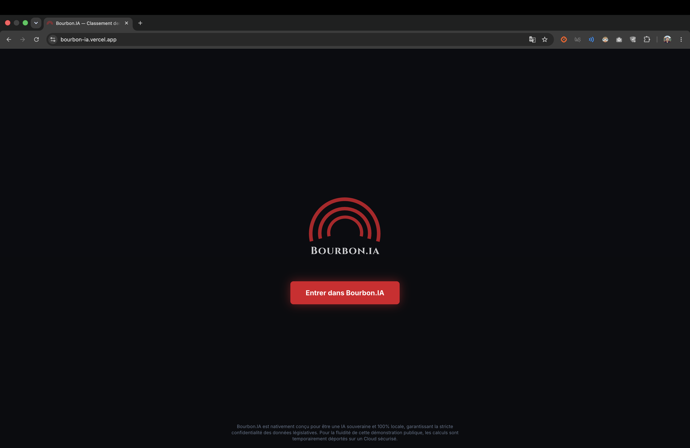
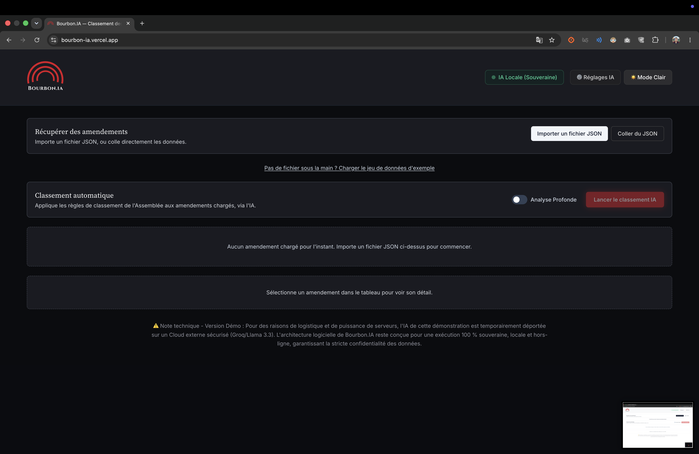
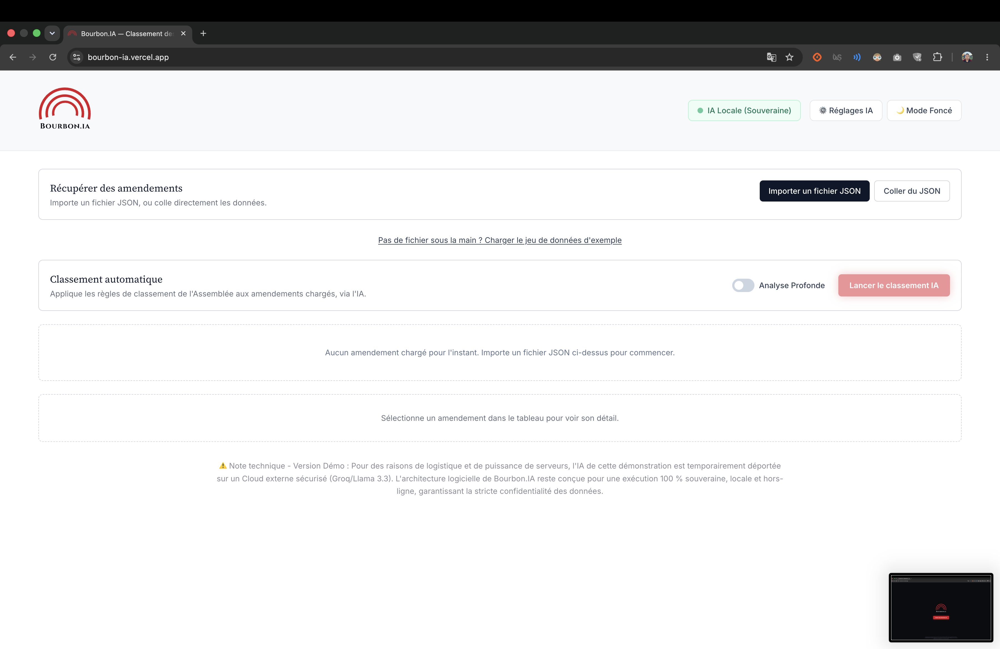
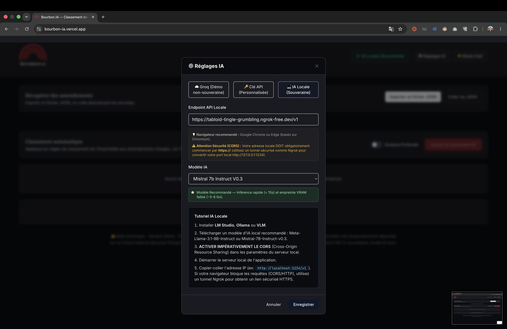
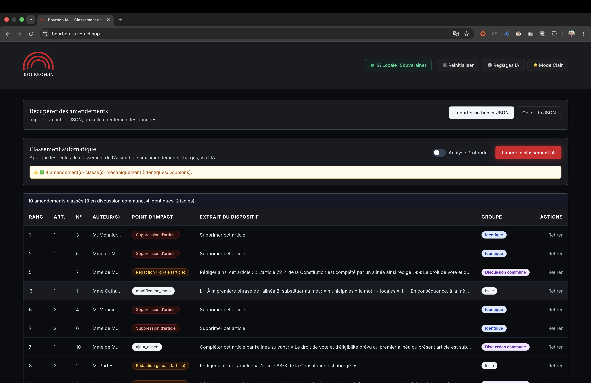

# 🇫🇷 Bourbon.IA — L'Assistant Législatif 100 % Local

**🔗 Démonstration en ligne :** [bourbon-ia.vercel.app](https://bourbon-ia.vercel.app)

---

## 🎯 Le Défi : L'enfer des 48 heures et la Souveraineté

Grâce à l'expertise métier d'un administrateur de l'Assemblée nationale présent dans notre équipe, nous avons ciblé le vrai blocage : le traitement de volumes écrasants d'amendements dans des délais inhumains. Lors de la réforme des retraites en 2023, **20 400 amendements** ont dû être triés, classés et analysés en **moins de 48 heures** par les équipes parlementaires.

Pour des questions de **confidentialité absolue**, l'usage d'IA Cloud classiques (OpenAI, Anthropic, etc.) est strictement interdit sur les textes législatifs en cours d'examen. Il fallait une solution **"Air-Gapped"** : une IA souveraine, locale, déconnectée d'Internet, capable de tourner intégralement sur les machines de l'Assemblée.

Bourbon.IA est cette solution.

### 🎬 Démonstration Vidéo
[](https://drive.google.com/file/d/1qQ96TeCVFPa59oXvuGqRI4gyOHlKo6OB/view?usp=sharing)

*Cliquez sur l'image ci-dessus pour lire la vidéo de démonstration complète (sur Google Drive).*

### 📸 Aperçu de l'Interface






---

## 💡 La Solution & Architecture (MVP V1)

### Pré-tri déterministe (sans IA)
L'interface React gère l'import de multiples fichiers JSON (format officiel de l'Assemblée nationale). Le serveur FastAPI effectue d'abord un **tri mécanique instantané, sans IA** : identiques, doublons (même texte, même auteur, même commission), irrecevabilités (Art. 40 / Art. 45) et amendements isolés sur leur zone d'impact. Ce pré-tri déterministe économise les ressources IA en ne transmettant au LLM que les amendements réellement ambigus.

### Sécurité & Architecture — Monolithe Assumé
Pour les besoins du Hackathon, le prototype est un monolithe volontaire. Ce choix d'architecture favorise la vélocité d'itération et la démonstration rapide.

> **🔒 Où vont les données ?**
> - **IA locale (mode souverain)** : les amendements sont traités par le serveur Bourbon.IA et le LLM installé sur le poste ou le réseau interne. **Rien ne sort.** C'est le mode par défaut quand l'application tourne en local.
> - **Groq (Démo)** — démo publique en ligne uniquement : les amendements passent par le serveur Vercel puis sont envoyés à **Groq (États-Unis, hors UE)**. L'application l'annonce par une alerte avant chaque classement. À n'utiliser qu'avec des amendements **déjà publics**.
> - **Clés API** : une clé personnelle est stockée **chiffrée** dans le navigateur ; elle est transmise au serveur à chaque requête pour appeler Groq, mais n'y est jamais enregistrée et reste masquée dans les journaux. La clé de la démo publique est une variable d'environnement du serveur, jamais envoyée au navigateur.
> - **Texte de loi de référence** : seul l'identifiant public du texte est demandé à l'API Tricoteuses (désactivable avec `BOURBON_TEXTES_DISTANTS=0`).
> - **Import « 🏛️ Depuis l'Assemblée »** : les mots recherchés et l'identifiant public du dossier sont envoyés à l'API Tricoteuses, qui renvoie les amendements publiés (données ouvertes de l'AN). Aucune donnée de l'utilisateur ne sort. Désactivé par le même `BOURBON_TEXTES_DISTANTS=0` (mode hors-ligne).
> - **Serveur Bourbon.IA** (⚙️ Réglages IA) : « En ligne » (serveur de la démo, Vercel) ou « Sur cet ordinateur » (`uvicorn api.index:app --port 8000`) — les amendements ne passent alors plus par le serveur en ligne. Les gros envois sont compressés (gzip) pour respecter la limite de 4,5 Mo par requête de Vercel.
> - **Référentiel des députés** : hors-ligne — députés en exercice et historique depuis 1997 (jeu AMO30, reconstruit par `scripts/construire_deputes_historique.py`).

Pour une mise en production, l'architecture évoluera vers des **Micro-services conteneurisés** (Docker/K8s) avec chiffrement de bout en bout.

### 🧠 Moteurs LLM & Inférence Locale Dynamique
L'application est configurée pour fonctionner en local avec une gestion intelligente de la mémoire vidéo (VRAM). Le Front-end interroge l'API native du serveur local, calcule l'empreinte mémoire au mégaoctet près, décharge automatiquement les anciens modèles pour éviter les crashs (*Out of Memory*), et adapte ses prompts selon l'architecture du modèle.

Notre configuration de référence :
| Modèle | Type | Usage recommandé |
|---|---|---|
| **Meta-Llama 3.1 8B / Mistral 7B** | Instruct | ⭐ **Modèle Recommandé :** Inférence ultra-rapide (< 15s) et classification parfaite. Idéal pour les GPU standards (8 Go VRAM). |
| **Gemma 4 12B (QAT)** | Reasoning | 🟡 **Analyse approfondie :** Pensée bridée automatiquement par le front-end pour optimiser la vitesse sans perdre en précision. |
| **Qwen 3.5 35B / QWQ 32B** | Dense | 🔵 **Traitement volumineux :** Modèles lourds réservés aux serveurs disposant de plus de 16 Go de VRAM. |

### ⚡ Innovations V1.5 (Gestion Adaptative)
- Déchargement automatique de la VRAM (Unload) lors de la bascule de modèle local dans la modale.
- Adaptation dynamique des prompts et des températures (0.1 vs 0.2) selon l'architecture du modèle (Reasoning vs Instruct).
- Détection heuristique de la VRAM via l'API native `v0` de LM Studio.

---

## 🚀 Roadmap Technique (V2)

- **Connexion MCP (Model Context Protocol) :** Branchement direct sur les flux de données de l'Assemblée nationale pour aspirer les amendements en temps réel, sans import manuel.
- **DeepSeek OCR :** Ingestion et structuration automatique des anciens amendements scannés ou au format PDF non-exploitable.
- **Recherche Sémantique (RAG) :** Déploiement de Qdrant et AnythingLLM pour interroger l'historique législatif complet de l'Assemblée et sourcer chaque réponse de l'IA avec des références exactes.
- **Architecture Micro-services :** Séparation du moteur de tri, du serveur LLM et de l'API Gateway dans des conteneurs indépendants pour la scalabilité et la résilience.

---

## ⚙️ Installation & Lancement

### Prérequis
- **Node.js 18+** et **npm**
- **Python 3.10+** (pour le backend FastAPI)
- **LM Studio** (pour le mode IA locale, sur le port `1234`)

### Front-End (React / Vite)
```bash
# Installer les dépendances
npm install

# Lancer le serveur de développement (port 5173)
npm run dev
```

### Back-End Python (FastAPI)
En production (sur Vercel), le backend tourne de manière autonome et Serverless. En environnement local, il est impératif de lancer le serveur manuellement :

```bash
# Optionnel : activer un environnement virtuel
python3 -m venv .venv
source .venv/bin/activate

# Installer les dépendances
pip install -r requirements.txt

# Lancer le serveur (port 8000)
uvicorn api.index:app --reload
```

### LLM Local (LM Studio)
1. Installer [LM Studio](https://lmstudio.ai/)
2. Charger un modèle (ex: Bonsai 27B, Mistral 7B, Qwen 2.5)
3. Démarrer le serveur local sur le port `1234`
4. **Activer le CORS** dans les paramètres du serveur LM Studio
5. Dans Bourbon.IA, ouvrir les ⚙️ Réglages IA et sélectionner "IA Locale"

---

## 👥 L'Équipe

| Rôle | Nom |
|---|---|
| **Porteur de projet** | Justin Bandiola |
| **Expertise métier** | Un administrateur de l'Assemblée nationale |
| **Contributeurs** | Yassine Yamani, Ralph Ferghali, Basile Nordmann, Sahel Salimi, Anwar Labib, Claudia Trujillo, Nicaise CHOUNGMO FOFACK |

---

*Hackathon Assemblée nationale 2026 — Équipe Bourbon.IA*
